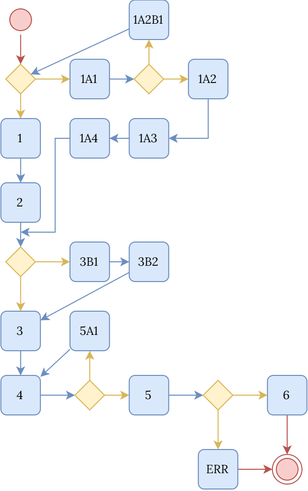

# SOFTWARE TESTING

---

# Test Design Techniques

## Black Box Testing

### Boundary Value Analysis

#### Room Booking Validation

Hệ thống đặt phòng của một trường đại học cho phép người dùng đăng ký đặt phòng bằng cách nhập các dữ liệu sau:

| Data field | Description | Valid range |
| --- | --- | --- |
| `Duration` | Thời gian sử dụng phòng tính bằng phút | 30 <= `Duration` <= 180 |
| `Number of Students` | Số lượng sinh viên tham gia | 1 <= `Number of Students` <= 50 |

Hệ thống áp dụng các quy tắc kiểm tra tính hợp lệ (validation rules) sau:
- Nếu `Duration` nhỏ hơn 30 hoặc lớn hơn 180, yêu cầu phải bị từ chối và hiển thị thông báo lỗi.
- Nếu `Number of Students` nhỏ hơn 1 hoặc lớn hơn 50, yêu cầu phải bị từ chối và hiển thị thông báo lỗi.
- Yêu cầu đặt phòng chỉ được chấp nhận khi cả hai trường dữ liệu đều nằm trong phạm vi hợp lệ của chúng.

Giả định các giá trị danh nghĩa (nominal values) như sau:
- Giá trị danh nghĩa của `Duration` là 90 phút.
- Giá trị danh nghĩa của `Number of Students` là 25 sinh viên.

Sử dụng Boundary Value Analysis (BVA), hãy thiết kế các tập test case cho hệ thống trên bằng cách áp dụng lần lượt bốn phương pháp sau: Normal BVA, Robust BVA, Worst-case BVA, và Robust Worst-case BVA. Đối với mỗi phương pháp, hãy giải thích cách tính số lượng test case được tạo ra, xác định các giá trị kiểm thử (test values) được chọn cho mỗi biến, và trình bày các test case dưới dạng bảng.

Giả định cả hai trường `Duration` và `Number of Students` đều là số nguyên. Hệ thống không chấp nhận giá trị thập phân, ký tự hoặc dữ liệu không đúng định dạng. Các test case trong bài tập tập trung vào kiểm thử ranh giới của miền giá trị số nguyên.

**Lời giải chi tiết**

Để thiết kế BVA test set, trước tiên ta cần xác định các phạm vi hợp lệ, giá trị danh nghĩa, và sau đó sinh ra các giá trị biên cho từng biến đầu vào. Có 2 biến đầu vào:

| Variable | Valid range | Nominal value |
| --- | --- | --- |
| `Duration` | 30 -> 180 | 90 |
| `Number of Students` | 1 -> 50 | 25 |

Hệ thống chấp nhận việc đặt phòng khi cả `Duration` và `Number of Students` đều hợp lệ. Nếu một hoặc cả hai biến không hợp lệ, hệ thống sẽ hiển thị lỗi tương ứng.

Đối với Normal BVA, ta chọn các giá trị biên và các giá trị ngay bên trong biên, sau đó thay đổi từng biến một trong khi giữ nguyên các biến khác ở giá trị danh nghĩa. Nghĩa là kiểm tra các giá trị biên hợp lệ và các giá trị cận biên hợp lệ, chỉ thay đổi một biến tại một thời điểm trong khi giữ biến còn lại ở giá trị danh nghĩa.

Đối với mỗi biến, ta chọn 5 giá trị:

| Variable | Normal BVA values |
| --- | --- |
| `Duration` | 30, 31, 90, 179, 180 |
| `Number of Students` | 1, 2, 25, 49, 50 |

Số lượng test case là:

$$
4n + 1 = 4 \times 2 + 1 = 9\ \text{test cases}
$$

Thiết kế bảng test case:

| Test case | `Duration` | `Number of Students` | Expected result |
| --- | --- | --- | --- |
| TC-001 | 90 | 25 | Accept booking |
| TC-002 | 30 | 25 | Accept booking |
| TC-003 | 31 | 25 | Accept booking |
| TC-004 | 179 | 25 | Accept booking |
| TC-005 | 180 | 25 | Accept booking |
| TC-006 | 90 | 1 | Accept booking |
| TC-007 | 90 | 2 | Accept booking |
| TC-008 | 90 | 49 | Accept booking |
| TC-009 | 90 | 50 | Accept booking |

Đối với Robust BVA, ta thêm các giá trị ngay bên ngoài mỗi biên hợp lệ để có thể kiểm thử cả các trường hợp biên hợp lệ và không hợp lệ. Đối với mỗi biến, ta chọn 7 giá trị:

| Variable | Robust BVA values |
| --- | --- |
| `Duration` | 29, 30, 31, 90, 179, 180, 181 |
| `Number of Students` | 0, 1, 2, 25, 49, 50, 51 |

Số lượng test case là:

$$
6n + 1 = 6 \times 2 + 1 = 13\ \text{test cases}
$$

Thiết kế bảng test case:

| Test case | `Duration` | `Number of Students` | Expected result |
| --- | --- | --- | --- |
| TC-001 | 90 | 25 | Accept booking |
| TC-002 | 29 | 25 | Error: invalid `Duration` |
| TC-003 | 30 | 25 | Accept booking |
| TC-004 | 31 | 25 | Accept booking |
| TC-005 | 179 | 25 | Accept booking |
| TC-006 | 180 | 25 | Accept booking |
| TC-007 | 181 | 25 | Error: invalid `Duration` |
| TC-008 | 90 | 0 | Error: invalid `Number of Students` |
| TC-009 | 90 | 1 | Accept booking |
| TC-010 | 90 | 2 | Accept booking |
| TC-011 | 90 | 49 | Accept booking |
| TC-012 | 90 | 50 | Accept booking |
| TC-013 | 90 | 51 | Error: invalid `Number of Students` |

Đối với Worst-case BVA, ta sử dụng các giá trị biên hợp lệ giống như Normal BVA, nhưng kiểm thử tất cả các kết hợp giữa các biến bằng cách lấy tích Cartesian của các giá trị biên hợp lệ.

| Variable | Worst-case BVA values |
| --- | --- |
| `Duration` | 30, 31, 90, 179, 180 |
| `Number of Students` | 1, 2, 25, 49, 50 |

Số lượng test case là:

$$
5^n = 5^2 = 25\ \text{test cases}
$$

Thiết kế bảng test case:

| Test case | `Duration` | `Number of Students` | Expected result |
| --- | --- | --- | --- |
| TC-001 | 30 | 1 | Accept booking |
| TC-002 | 30 | 2 | Accept booking |
| TC-003 | 30 | 25 | Accept booking |
| TC-004 | 30 | 49 | Accept booking |
| TC-005 | 30 | 50 | Accept booking |
| TC-006 | 31 | 1 | Accept booking |
| TC-007 | 31 | 2 | Accept booking |
| TC-008 | 31 | 25 | Accept booking |
| TC-009 | 31 | 49 | Accept booking |
| TC-010 | 31 | 50 | Accept booking |
| TC-011 | 90 | 1 | Accept booking |
| TC-012 | 90 | 2 | Accept booking |
| TC-013 | 90 | 25 | Accept booking |
| TC-014 | 90 | 49 | Accept booking |
| TC-015 | 90 | 50 | Accept booking |
| TC-016 | 179 | 1 | Accept booking |
| TC-017 | 179 | 2 | Accept booking |
| TC-018 | 179 | 25 | Accept booking |
| TC-019 | 179 | 49 | Accept booking |
| TC-020 | 179 | 50 | Accept booking |
| TC-021 | 180 | 1 | Accept booking |
| TC-022 | 180 | 2 | Accept booking |
| TC-023 | 180 | 25 | Accept booking |
| TC-024 | 180 | 49 | Accept booking |
| TC-025 | 180 | 50 | Accept booking |

Đối với Robust Worst-case BVA, ta sử dụng cả giá trị hợp lệ và không hợp lệ gần biên, và kiểm thử tất cả các kết hợp bằng cách lấy tích Cartesian của các giá trị biên, cận biên và ngoài phạm vi.

| Variable | Robust Worst-case BVA values |
| --- | --- |
| `Duration` | 29, 30, 31, 90, 179, 180, 181 |
| `Number of Students` | 0, 1, 2, 25, 49, 50, 51 |

Số lượng test case là:

$$
7^n = 7^2 = 49\ \text{test cases}
$$

Thiết kế bảng test case:

| Test case | `Duration` | `Number of Students` | Expected result |
| --- | --- | --- | --- |
| TC-001 | 29 | 0 | Error: invalid `Duration` and `Number of Students` |
| TC-002 | 29 | 1 | Error: invalid `Duration` |
| TC-003 | 29 | 2 | Error: invalid `Duration` |
| TC-004 | 29 | 25 | Error: invalid `Duration` |
| TC-005 | 29 | 49 | Error: invalid `Duration` |
| TC-006 | 29 | 50 | Error: invalid `Duration` |
| TC-007 | 29 | 51 | Error: invalid `Duration` and `Number of Students` |
| TC-008 | 30 | 0 | Error: invalid `Number of Students` |
| TC-009 | 30 | 1 | Accept booking |
| TC-010 | 30 | 2 | Accept booking |
| TC-011 | 30 | 25 | Accept booking |
| TC-012 | 30 | 49 | Accept booking |
| TC-013 | 30 | 50 | Accept booking |
| TC-014 | 30 | 51 | Error: invalid `Number of Students` |
| TC-015 | 31 | 0 | Error: invalid `Number of Students` |
| TC-016 | 31 | 1 | Accept booking |
| TC-017 | 31 | 2 | Accept booking |
| TC-018 | 31 | 25 | Accept booking |
| TC-019 | 31 | 49 | Accept booking |
| TC-020 | 31 | 50 | Accept booking |
| TC-021 | 31 | 51 | Error: invalid `Number of Students` |
| TC-022 | 90 | 0 | Error: invalid `Number of Students` |
| TC-023 | 90 | 1 | Accept booking |
| TC-024 | 90 | 2 | Accept booking |
| TC-025 | 90 | 25 | Accept booking |
| TC-026 | 90 | 49 | Accept booking |
| TC-027 | 90 | 50 | Accept booking |
| TC-028 | 90 | 51 | Error: invalid `Number of Students` |
| TC-029 | 179 | 0 | Error: invalid `Number of Students` |
| TC-030 | 179 | 1 | Accept booking |
| TC-031 | 179 | 2 | Accept booking |
| TC-032 | 179 | 25 | Accept booking |
| TC-033 | 179 | 49 | Accept booking |
| TC-034 | 179 | 50 | Accept booking |
| TC-035 | 179 | 51 | Error: invalid `Number of Students` |
| TC-036 | 180 | 0 | Error: invalid `Number of Students` |
| TC-037 | 180 | 1 | Accept booking |
| TC-038 | 180 | 2 | Accept booking |
| TC-039 | 180 | 25 | Accept booking |
| TC-040 | 180 | 49 | Accept booking |
| TC-041 | 180 | 50 | Accept booking |
| TC-042 | 180 | 51 | Error: invalid `Number of Students` |
| TC-043 | 181 | 0 | Error: invalid `Duration` and `Number of Students` |
| TC-044 | 181 | 1 | Error: invalid `Duration` |
| TC-045 | 181 | 2 | Error: invalid `Duration` |
| TC-046 | 181 | 25 | Error: invalid `Duration` |
| TC-047 | 181 | 49 | Error: invalid `Duration` |
| TC-048 | 181 | 50 | Error: invalid `Duration` |
| TC-049 | 181 | 51 | Error: invalid `Duration` and `Number of Students` |

Với giả định hai trường dữ liệu được kiểm tra độc lập và mục tiêu chủ yếu là phát hiện lỗi validation tại các giá trị biên, Robust BVA là lựa chọn hiệu quả về số lượng test case và phạm vi kiểm thử. Tuy nhiên, kỹ thuật này không bảo đảm phát hiện các lỗi phát sinh từ tương tác giữa nhiều đầu vào.

Nếu chỉ dùng Normal BVA, ta không kiểm tra dữ liệu ngoài biên như 29, 181, 0, 51, nên chưa đủ tốt cho validation. Nếu dùng Worst-case BVA, ta có 25 test case, nhưng vẫn không kiểm tra invalid. Nếu dùng Robust Worst-case BVA, ta có 49 test case. Độ phủ cao nhất, nhưng khá tốn công và nhiều trường hợp có thể dư thừa nếu `Duration` và Students được validate độc lập.

Vì vậy, với giả định hai trường được validation độc lập, Robust BVA là lựa chọn cân bằng nhất: chỉ cần 13 test case nhưng vẫn kiểm tra được cả biên hợp lệ và biên không hợp lệ. Đây là kỹ thuật vừa đủ mạnh để bắt lỗi validation ở biên, vừa không làm số lượng test case tăng quá nhiều. Nếu hai trường có ràng buộc tương tác, cần bổ sung các tổ hợp liên quan hoặc dùng Worst-case/Robust Worst-case.

#### Seminar Registration System

Hệ thống đăng ký hội thảo học thuật của một trường đại học cho phép người dùng nhập các thông tin sau:

| Data field | Description | Valid range |
| --- | --- | --- |
| `Age` | Tuổi của người tham gia | 18 <= `Age` <= 65 |
| `Experience` | Số năm kinh nghiệm nghiên cứu | 0 <= `Experience` <= 40 |
| `Registration Days Before Event` | Số ngày người dùng đăng ký trước ngày diễn ra hội thảo | 1 <= `Registration Days Before Event` <= 180 |
| `Number of Workshops` | Số lượng workshop người dùng muốn tham dự | 1 <= `Number of Workshops` <= 10 |

Hệ thống áp dụng các quy tắc validation sau:
- Nếu `Age` nhỏ hơn 18 hoặc lớn hơn 65, việc đăng ký phải bị từ chối và hiển thị thông báo lỗi.
- Nếu `Experience` nhỏ hơn 0 hoặc lớn hơn 40, việc đăng ký phải bị từ chối và hiển thị thông báo lỗi.
- Nếu `Registration Days Before Event` nhỏ hơn 1 hoặc lớn hơn 180, việc đăng ký phải bị từ chối và hiển thị thông báo lỗi.
- Nếu `Number of Workshops` nhỏ hơn 1 hoặc lớn hơn 10, việc đăng ký phải bị từ chối và hiển thị thông báo lỗi.
- Việc đăng ký chỉ được chấp nhận khi tất cả các trường dữ liệu đều nằm trong phạm vi hợp lệ của chúng.

Giả định các giá trị nominal như sau:
- `Age` = 30
- `Experience` = 10
- `Registration Days Before Event` = 90
- `Number of Workshops` = 5

Sử dụng Boundary Value Analysis (BVA), hãy thiết kế các tập test case cho hệ thống trên bằng cách áp dụng lần lượt bốn phương pháp sau: Normal BVA, Robust BVA, Worst-case BVA, và Robust Worst-case BVA. Đối với mỗi phương pháp:
- Giải thích cách tính số lượng test case được tạo ra.
- Xác định các giá trị kiểm thử được chọn cho mỗi biến.
- Trình bày các test case dưới dạng bảng.
- Đối với Worst-case BVA và Robust Worst-case BVA, chỉ trình bày một vài test case đại diện.

**Lời giải chi tiết**

Để thiết kế các tập test case BVA, trước ta cần xác định các phạm vi hợp lệ, các giá trị nominal, và các giá trị biên cho từng biến đầu vào. Có 4 biến đầu vào:

| Variable | Valid range | Nominal value |
| --- | --- | --- |
| `Age` | 18 -> 65 | 30 |
| `Experience` | 0 -> 40 | 10 |
| `Registration Days Before Event` | 1 -> 180 | 90 |
| `Number of Workshops` | 1 -> 10 | 5 |

Hệ thống chỉ chấp nhận đăng ký khi tất cả các biến đều hợp lệ. Nếu một hoặc nhiều biến không hợp lệ, hệ thống sẽ hiển thị lỗi tương ứng.

Đối với Normal BVA, ta kiểm tra các giá trị biên hợp lệ và các giá trị hợp lệ cận biên. Chỉ có một biến được thay đổi tại một thời điểm trong khi các biến khác giữ nguyên ở giá trị nominal.

Đối với mỗi biến, ta chọn 5 giá trị:

| Variable | Normal BVA values |
| --- | --- |
| `Age` | 18, 19, 30, 64, 65 |
| `Experience` | 0, 1, 10, 39, 40 |
| `Registration Days Before Event` | 1, 2, 90, 179, 180 |
| `Number of Workshops` | 1, 2, 5, 9, 10 |

Số lượng test case là:

$$
4n + 1 = 4 \times 4 + 1 = 17\ \text{test cases}
$$

Thiết kế test case:

| Test case | `Age` | `Experience` | `Registration Days Before Event` | Workshops | Expected result |
| --- | --- | --- | --- | --- | --- |
| TC-001 | 30 | 10 | 90 | 5 | Accept registration |
| TC-002 | 18 | 10 | 90 | 5 | Accept registration |
| TC-003 | 19 | 10 | 90 | 5 | Accept registration |
| TC-004 | 64 | 10 | 90 | 5 | Accept registration |
| TC-005 | 65 | 10 | 90 | 5 | Accept registration |
| TC-006 | 30 | 0 | 90 | 5 | Accept registration |
| TC-007 | 30 | 1 | 90 | 5 | Accept registration |
| TC-008 | 30 | 39 | 90 | 5 | Accept registration |
| TC-009 | 30 | 40 | 90 | 5 | Accept registration |
| TC-010 | 30 | 10 | 1 | 5 | Accept registration |
| TC-011 | 30 | 10 | 2 | 5 | Accept registration |
| TC-012 | 30 | 10 | 179 | 5 | Accept registration |
| TC-013 | 30 | 10 | 180 | 5 | Accept registration |
| TC-014 | 30 | 10 | 90 | 1 | Accept registration |
| TC-015 | 30 | 10 | 90 | 2 | Accept registration |
| TC-016 | 30 | 10 | 90 | 9 | Accept registration |
| TC-017 | 30 | 10 | 90 | 10 | Accept registration |

Đối với Robust BVA, ta kiểm tra cả giá trị hợp lệ và giá trị không hợp lệ ngay bên ngoài các đường biên. Chỉ có một biến được thay đổi tại một thời điểm trong khi các biến khác giữ nguyên ở giá trị nominal.

Đối với mỗi biến, ta chọn 7 giá trị:

| Variable | Robust BVA values |
| --- | --- |
| `Age` | 17, 18, 19, 30, 64, 65, 66 |
| `Experience` | -1, 0, 1, 10, 39, 40, 41 |
| `Registration Days Before Event` | 0, 1, 2, 90, 179, 180, 181 |
| `Number of Workshops` | 0, 1, 2, 5, 9, 10, 11 |

Số lượng test case là:

$$
6n + 1 = 6 \times 4 + 1 = 25\ \text{test cases}
$$

Thiết kế test case:

| Test case | `Age` | `Experience` | `Registration Days Before Event` | Workshops | Expected result |
| --- | --- | --- | --- | --- | --- |
| TC-001 | 30 | 10 | 90 | 5 | Accept registration |
| TC-002 | 17 | 10 | 90 | 5 | Error: invalid `Age` |
| TC-003 | 18 | 10 | 90 | 5 | Accept registration |
| TC-004 | 19 | 10 | 90 | 5 | Accept registration |
| TC-005 | 64 | 10 | 90 | 5 | Accept registration |
| TC-006 | 65 | 10 | 90 | 5 | Accept registration |
| TC-007 | 66 | 10 | 90 | 5 | Error: invalid `Age` |
| TC-008 | 30 | -1 | 90 | 5 | Error: invalid `Experience` |
| TC-009 | 30 | 0 | 90 | 5 | Accept registration |
| TC-010 | 30 | 1 | 90 | 5 | Accept registration |
| TC-011 | 30 | 39 | 90 | 5 | Accept registration |
| TC-012 | 30 | 40 | 90 | 5 | Accept registration |
| TC-013 | 30 | 41 | 90 | 5 | Error: invalid `Experience` |
| TC-014 | 30 | 10 | 0 | 5 | Error: invalid `Registration Days Before Event` |
| TC-015 | 30 | 10 | 1 | 5 | Accept registration |
| TC-016 | 30 | 10 | 2 | 5 | Accept registration |
| TC-017 | 30 | 10 | 179 | 5 | Accept registration |
| TC-018 | 30 | 10 | 180 | 5 | Accept registration |
| TC-019 | 30 | 10 | 181 | 5 | Error: invalid `Registration Days Before Event` |
| TC-020 | 30 | 10 | 90 | 0 | Error: invalid `Number of Workshops` |
| TC-021 | 30 | 10 | 90 | 1 | Accept registration |
| TC-022 | 30 | 10 | 90 | 2 | Accept registration |
| TC-023 | 30 | 10 | 90 | 9 | Accept registration |
| TC-024 | 30 | 10 | 90 | 10 | Accept registration |
| TC-025 | 30 | 10 | 90 | 11 | Error: invalid `Number of Workshops` |

Đối với Worst-case BVA, ta sử dụng các giá trị biên hợp lệ tương tự như Normal BVA, nhưng kiểm thử tất cả các kết hợp giữa các biến bằng cách lấy tích Cartesian của các giá trị biên hợp lệ.

Đối với mỗi biến, ta chọn 5 giá trị:

| Variable | Worst-case BVA values |
| --- | --- |
| `Age` | 18, 19, 30, 64, 65 |
| `Experience` | 0, 1, 10, 39, 40 |
| `Registration Days Before Event` | 1, 2, 90, 179, 180 |
| `Number of Workshops` | 1, 2, 5, 9, 10 |

Số lượng test case là:

$$
5^n = 5^4 = 625\ \text{test cases}
$$

Thiết kế test case:

| Test case | `Age` | `Experience` | `Registration Days Before Event` | Workshops | Expected result |
| --- | --- | --- | --- | --- | --- |
| TC-001 | 18 | 0 | 1 | 1 | Accept registration |
| TC-002 | 19 | 0 | 1 | 1 | Accept registration |
| TC-003 | 30 | 0 | 1 | 1 | Accept registration |
| TC-004 | 64 | 0 | 1 | 1 | Accept registration |
| TC-005 | 65 | 0 | 1 | 1 | Accept registration |
| ... | ... | ... | ... | ... | ... |
| TC-625 | 65 | 40 | 180 | 10 | Accept registration |

Đối với Robust Worst-case BVA, ta sử dụng cả giá trị hợp lệ và không hợp lệ gần các đường biên, đồng thời kiểm thử tất cả các kết hợp giữa các biến.

Đối với mỗi biến, ta chọn 7 giá trị:

| Variable | Robust Worst-case BVA values |
| --- | --- |
| `Age` | 17, 18, 19, 30, 64, 65, 66 |
| `Experience` | -1, 0, 1, 10, 39, 40, 41 |
| `Registration Days Before Event` | 0, 1, 2, 90, 179, 180, 181 |
| `Number of Workshops` | 0, 1, 2, 5, 9, 10, 11 |

Số lượng test case là:

$$
7^n = 7^4 = 2401\ \text{test cases}
$$

Thiết kế test case:

| Test case | `Age` | `Experience` | `Registration Days Before Event` | Workshops | Expected result |
| --- | --- | --- | --- | --- | --- |
| TC-001 | 17 | 0 | 1 | 1 | Error: invalid `Age` |
| TC-002 | 18 | 0 | 1 | 1 | Accept registration |
| TC-003 | 19 | 0 | 1 | 1 | Accept registration |
| TC-004 | 30 | 0 | 1 | 1 | Accept registration |
| TC-005 | 64 | 0 | 1 | 1 | Accept registration |
| TC-006 | 65 | 0 | 1 | 1 | Accept registration |
| TC-007 | 66 | 0 | 1 | 1 | Error: invalid `Age` |
| ... | ... | ... | ... | ... | ... |
| TC-2401 | 66 | 41 | 181 | 11 | Error: invalid `Age`, `Experience`, `Registration Days Before Event`, `Number of Workshops` |

### Equivalence Partitioning

#### Movie Ticket Booking

Một hệ thống đặt vé xem phim cho phép khách hàng đặt vé bằng cách nhập hai thông tin:

| Data field | Description | Valid range |
| --- | --- | --- |
| `Age` | Tuổi của khách hàng | 6-80 |
| `Seat type` | Loại ghế được chọn bởi khách hàng | S, P |

Hệ thống phải kiểm tra tính hợp lệ của dữ liệu đầu vào theo các quy tắc sau:

**Nhóm tuổi:**
- Khách hàng từ 6 đến 12 tuổi được xếp vào nhóm Child.
- Khách hàng từ 13 đến 59 tuổi được xếp vào nhóm Adult.
- Khách hàng từ 60 đến 80 tuổi được xếp vào nhóm Senior.
- Bất kỳ độ tuổi nào nhỏ hơn 6 hoặc lớn hơn 80 đều không hợp lệ.

**Loại ghế:**
- Ghế Standard được nhập là S.
- Ghế Premium được nhập là P.
- Nếu không có loại ghế nào được chọn, hệ thống phải hiển thị thông báo lỗi.
- Nếu người dùng nhập bất kỳ giá trị nào khác ngoài S hoặc P, hệ thống phải hiển thị thông báo lỗi.

Yêu cầu đặt vé chỉ được chấp nhận khi cả `Age` và `Seat type` đều hợp lệ.

Sử dụng Equivalence Class Partitioning (ECP), hãy thiết kế các tập test case cho hệ thống trên bằng cách áp dụng lần lượt bốn kỹ thuật sau: Weak Normal ECP, Strong Normal ECP, Weak Robust ECP, và Strong Robust ECP. Đối với mỗi kỹ thuật:
- Giải thích cách xác định số lượng test case được tạo ra.
- Xác định các tương đương (equivalence classes) được sử dụng cho mỗi đầu vào.
- Trình bày các test case dưới dạng bảng.
- Đối với Strong Robust ECP, chỉ trình bày một vài test case đại diện.

**Lời giải chi tiết**

Để thiết kế các tập test case ECP, trước tiên ta cần xác định các equivalence classes cho từng biến đầu vào. Hệ thống chỉ chấp nhận đặt vé khi cả hai đầu vào đều thuộc về các equivalence classes hợp lệ:

| Variable | Equivalence class | Value | Type |
| --- | --- | --- | --- |
| `Age group` | EC1 | 6-12 | Valid: Child |
| `Age group` | EC2 | 13-59 | Valid: Adult |
| `Age group` | EC3 | 60-80 | Valid: Senior |
| `Age group` | EC4 | < 6 | Invalid |
| `Age group` | EC5 | > 80 | Invalid |
| `Seat type` | EC6 | S | Valid: Standard |
| `Seat type` | EC7 | P | Valid: Premium |
| `Seat type` | EC8 | Blank | Invalid |
| `Seat type` | EC9 | Any value other than S, P or Blank | Invalid |

Giả định `Age` là trường bắt buộc và chỉ nhận số nguyên. Nếu giao diện cho phép nhập Blank, ký tự hoặc số thập phân thì cần bổ sung các lớp không hợp lệ tương ứng.

Đối với Weak Normal ECP, ta chọn một đại diện từ mỗi lớp hợp lệ và đảm bảo mọi lớp hợp lệ đều xuất hiện ít nhất một lần: EC1, EC2, EC3, EC6, EC7.

Thiết kế test case:

| Test case | `Age` | `Seat type` | Covered classes | Expected result |
| --- | --- | --- | --- | --- |
| TC-001 | 8 | S | EC1, EC6 | Accept booking: Child, Standard |
| TC-002 | 25 | P | EC2, EC7 | Accept booking: Adult, Premium |
| TC-003 | 65 | S | EC3, EC6 | Accept booking: Senior, Standard |

Weak Normal ECP chỉ yêu cầu 3 test cases trong trường hợp này.

Đối với Weak Robust ECP, ta cần chọn cả lớp hợp lệ và không hợp lệ, nhưng vẫn chỉ yêu cầu mỗi lớp xuất hiện ít nhất một lần.

Thiết kế test case:

| Test case | `Age` | `Seat type` | Covered classes | Expected result |
| --- | --- | --- | --- | --- |
| TC-001 | 8 | S | EC1, EC6 | Accept booking: Child, Standard |
| TC-002 | 25 | P | EC2, EC7 | Accept booking: Adult, Premium |
| TC-003 | 65 | S | EC3, EC6 | Accept booking: Senior, Standard |
| TC-004 | 5 | S | EC4, EC6 | Error: invalid `Age` |
| TC-005 | 81 | P | EC5, EC7 | Error: invalid `Age` |
| TC-006 | 25 | Blank | EC2, EC8 | Error: missing `Seat type` |
| TC-007 | 25 | X | EC2, EC9 | Error: invalid `Seat type` |

Weak Robust ECP yêu cầu 7 test cases trong trường hợp này, ta chỉ cần mỗi lớp xuất hiện ít nhất một lần, không cần kết hợp mọi invalid age với mọi invalid seat.

Đối với Strong Normal ECP, ta kết hợp tất cả các lớp hợp lệ trên tất cả các đầu vào sao cho mỗi lớp hợp lệ được ghép cặp với mọi lớp hợp lệ khác.

Có 3 lớp age hợp lệ và 2 lớp seat hợp lệ, do đó số lượng test case là:

$$
3 \times 2 = 6\ \text{test cases}
$$

Thiết kế test case:

| Test case | `Age group` | `Seat type` | Expected result |
| --- | --- | --- | --- |
| TC-001 | 8 | S | Valid: Child, Standard |
| TC-002 | 8 | P | Valid: Child, Premium |
| TC-003 | 25 | S | Valid: Adult, Standard |
| TC-004 | 25 | P | Valid: Adult, Premium |
| TC-005 | 65 | S | Valid: Senior, Standard |
| TC-006 | 65 | P | Valid: Senior, Premium |

Đối với Strong Robust ECP, ta kết hợp tất cả các lớp hợp lệ và không hợp lệ trên tất cả các đầu vào, điều này tạo ra tập hợp lớn nhất.

Có 5 lớp age và 4 lớp seat, do đó số lượng test case là:

$$
5 \times 4 = 20\ \text{test cases}
$$

Thiết kế test case:

| Test case | `Age group` | `Seat type` | Expected result |
| --- | --- | --- | --- |
| TC-001 | 8 | S | Valid: Child, Standard |
| TC-002 | 8 | P | Valid: Child, Premium |
| TC-003 | 8 | Blank | Invalid: Child, Missing seat type |
| TC-004 | 8 | X | Invalid: Child, Invalid seat type |
| TC-005 | 25 | S | Valid: Adult, Standard |
| TC-006 | 25 | P | Valid: Adult, Premium |
| TC-007 | 25 | Blank | Invalid: Adult, Missing seat type |
| TC-008 | 25 | X | Invalid: Adult, Invalid seat type |
| TC-009 | 65 | S | Valid: Senior, Standard |
| TC-010 | 65 | P | Valid: Senior, Premium |
| TC-011 | 65 | Blank | Invalid: Senior, Missing seat type |
| TC-012 | 65 | X | Invalid: Senior, Invalid seat type |
| TC-013 | 5 | S | Invalid: Under 6, Standard |
| TC-014 | 5 | P | Invalid: Under 6, Premium |
| TC-015 | 5 | Blank | Invalid: Under 6, Missing seat type |
| TC-016 | 5 | X | Invalid: Under 6, Invalid seat type |
| TC-017 | 81 | S | Invalid: Over 80, Standard |
| TC-018 | 81 | P | Invalid: Over 80, Premium |
| TC-019 | 81 | Blank | Invalid: Over 80, Missing seat type |
| TC-020 | 81 | X | Invalid: Over 80, Invalid seat type |

Với tình huống bài tập đặt vé xem phim ở trên, kỹ thuật tối ưu nhất thường là Weak Robust ECP. Lý do là bài có cả dữ liệu hợp lệ và không hợp lệ: tuổi < 6, tuổi > 80, không chọn seat, chọn sai seat. Vì vậy nếu chỉ dùng Normal ECP thì chưa đủ tốt, vì nó bỏ qua các trường hợp lỗi. Tuy nhiên nếu dùng Strong Robust ECP thì quá nhiều test case: 20 test cases. Cách này phủ rất kỹ nhưng không tối ưu về thời gian, nhất là khi đây chỉ là bài toán có logic nhập liệu đơn giản.

#### Smart Locker System

Một hệ thống tủ gửi đồ tự động thông minh trong trường đại học cho phép sinh viên đặt tủ bằng cách nhập hai thông tin sau:

| Data field | Description | Valid range |
| --- | --- | --- |
| `Duration` | Thời gian gửi đồ (tính bằng phút) | 1 ≤ `Duration` ≤ 120 |
| `Locker size` | Loại tủ được chọn bởi người dùng | S, L, X |

Hệ thống kiểm tra tính hợp lệ và xử lý tính phí theo các quy tắc:
- Thời gian gửi đồ (`Duration`): chỉ nhận số nguyên tính bằng phút.
  - Từ 1 đến dưới 30 phút: Miễn phí (0 USD).
  - Từ 30 đến 120 phút: Phí cơ bản 1 USD.
  - Nhỏ hơn 1 phút hoặc lớn hơn 120 phút: Không hợp lệ.
- Loại tủ (`Locker size`):
  - Tủ nhỏ (S): Phụ phí +0 USD.
  - Tủ lớn (L): Phụ phí +1 USD.
  - Tủ cực lớn (X): Phụ phí +1.5 USD.

Nếu không chọn kích thước tủ hoặc nhập giá trị khác ngoài S, L, X: Không hợp lệ. Yêu cầu đặt tủ chỉ thành công khi cả `Duration` và `Locker size` đều hợp lệ. Khi vi phạm bất kỳ điều kiện nào, hệ thống hiển thị trạng thái lỗi và phát ra tiếng bíp.

Sử dụng kỹ thuật Equivalence Partitioning (ECP), hãy thiết kế các tập test case bằng cách áp dụng lần lượt bốn phương pháp: Weak Normal ECP, Strong Normal ECP, Weak Robust ECP, và Strong Robust ECP. Đối với mỗi kỹ thuật:
- Giải thích cách xác định số lượng test case.
- Xác định các tương đương (equivalence classes) cho từng đầu vào.
- Trình bày các test case dưới dạng bảng (đối với Strong Robust ECP, chỉ trình bày một vài test case đại diện).

**Lời giải chi tiết**

Để thiết kế các tập test case ECP, trước tiên ta cần xác định các equivalence classes cho từng biến đầu vào. Hệ thống chỉ chấp nhận yêu cầu đặt tủ khi cả hai đầu vào đều thuộc về các equivalence classes hợp lệ:

| Variable | Equivalence class | Value | Type |
| --- | --- | --- | --- |
| `Duration` | EC1 | 1-29 | Valid: Free |
| `Duration` | EC2 | 30-120 | Valid: Charged |
| `Duration` | EC3 | < 1 | Invalid |
| `Duration` | EC4 | > 120 | Invalid |
| `Locker size` | EC5 | S | Valid: Small |
| `Locker size` | EC6 | L | Valid: Large |
| `Locker size` | EC7 | X | Valid: Extra Large |
| `Locker size` | EC8 | Blank | Invalid: Missing |
| `Locker size` | EC9 | Any value other than S, L, X or Blank | Invalid: Other character |

Đối với Weak Normal ECP, ta chọn một đại diện từ mỗi lớp hợp lệ và đảm bảo mọi lớp hợp lệ đều xuất hiện ít nhất một lần: EC1, EC2, EC5, EC6, EC7.

Số lượng test case: Do biến `Locker size` có số lớp hợp lệ lớn nhất (3 lớp), số lượng test case tối thiểu là 3.

| Test case | `Duration` | `Locker size` | Covered classes | Expected Result |
| --- | --- | --- | --- | --- |
| TC-001 | 15 | S | EC1, EC5 | Success: Fee = 0 USD |
| TC-002 | 45 | L | EC2, EC6 | Success: Fee = 2 USD (1 + 1) |
| TC-003 | 60 | X | EC2, EC7 | Success: Fee = 2.5 USD (1 + 1.5) |

Đối với Weak Robust ECP, ta cần đảm bảo mọi lớp (cả hợp lệ lẫn không hợp lệ) xuất hiện ít nhất một lần. Áp dụng giả định lỗi đơn (Single Fault Assumption), mỗi test case không hợp lệ chỉ chứa đúng 1 giá trị không hợp lệ.

Số lượng test case: 3 (Normal) + 2 (Invalid `Duration`) + 2 (Invalid Size) = 7 test cases

| Test case | `Duration` | `Locker size` | Covered classes | Expected Result |
| --- | --- | --- | --- | --- |
| TC-001 | 15 | S | EC1, EC5 | Success: Fee = 0 USD |
| TC-002 | 45 | L | EC2, EC6 | Success: Fee = 2 USD (1 + 1) |
| TC-003 | 60 | X | EC2, EC7 | Success: Fee = 2.5 USD (1 + 1.5) |
| TC-004 | 0 | S | EC3, EC5 | Invalid: `Duration` < 1, Beep |
| TC-005 | 150 | L | EC4, EC6 | Invalid: `Duration` > 120, Beep |
| TC-006 | 45 | Blank | EC2, EC8 | Invalid: Missing locker size, Beep |
| TC-007 | 45 | K | EC2, EC9 | Invalid: Invalid locker size, Beep |

Đối với Strong Normal ECP, tất cả các lớp hợp lệ của biến này được kết hợp với tất cả các lớp hợp lệ của biến kia.

Có 2 lớp `Duration` hợp lệ và 3 lớp `Locker size` hợp lệ, do đó số lượng test case là:

$$
2 \times 3 = 6\ \text{test cases}
$$

| Test case | `Duration` | `Locker size` | Expected Result |
| --- | --- | --- | --- |
| TC-001 | 15 | S | Success: Fee = 0 USD |
| TC-002 | 15 | L | Success: Fee = 1 USD (0 + 1) |
| TC-003 | 15 | X | Success: Fee = 1.5 USD (0 + 1.5) |
| TC-004 | 45 | S | Success: Fee = 1 USD (1 + 0) |
| TC-005 | 45 | L | Success: Fee = 2 USD (1 + 1) |
| TC-006 | 45 | X | Success: Fee = 2.5 USD (1 + 1.5) |

Giá trị `Duration = 120` vẫn thuộc EC2 và phải được chấp nhận với phí cơ bản 1 USD; `Duration = 121` thuộc EC4 và phải bị từ chối. Đây là hai giá trị nên được kiểm tra thêm bằng BVA để xác nhận biên trên.

Đối với Strong Robust ECP, ta kết hợp tất cả các lớp hợp lệ và không hợp lệ của mọi đầu vào.

Có 4 lớp `Duration` và 5 lớp `Locker size`, do đó số lượng test case là:

$$
4 \times 5 = 20\ \text{test cases}
$$

| Test case | `Duration` | `Locker size` | Expected Result |
| --- | --- | --- | --- |
| TC-001 | 15 | S | Success: Fee = 0 USD |
| TC-002 | 45 | L | Success: Fee = 2 USD (1 + 1) |
| TC-003 | 0 | S | Invalid: `Duration` < 1, Beep |
| TC-004 | 45 | Blank | Invalid: Missing locker size, Beep |
| TC-005 | 0 | Blank | Invalid: `Duration` < 1 & Missing size, Beep |
| TC-006 | 150 | K | Invalid: `Duration` > 120 & Invalid size, Beep |
| ... | ... | ... | ... |

Đối với bài toán Smart Locker System, kỹ thuật Weak Robust ECP phù hợp để kiểm tra các lớp đầu vào hợp lệ và không hợp lệ với số lượng test case nhỏ. Tuy nhiên, do phí gửi đồ phụ thuộc đồng thời vào Duration và Locker size, nên kết hợp Strong Normal ECP để kiểm tra đầy đủ 6 tổ hợp tính phí, đồng thời bổ sung các test case không hợp lệ từ Weak Robust ECP.

#### Smart Loan System

Một ứng dụng ngân hàng số cho phép khách hàng đăng ký khoản vay tín chấp trực tuyến. Hệ thống yêu cầu người dùng nhập 3 thông tin đầu vào chính để duyệt tự động:

| Data field | Description | Valid range |
| --- | --- | --- |
| `Credit Score` | Điểm tín dụng của khách hàng | 300 ≤ `Credit Score` ≤ 850 |
| `Monthly Income` | Thu nhập hàng tháng (đơn vị: triệu VNĐ) | 10 ≤ `Monthly Income` ≤ 200 |
| `Employment Type` | Form hợp đồng lao động | Permanent (P), Contract (C), Freelance (F) |

Quy tắc xử lý và phê duyệt của hệ thống như sau:

1. Điều kiện về Điểm tín dụng (`Credit Score`):
- Từ 300 đến 599: Năng lực tín dụng yếu (Weak).
- Từ 600 đến 749: Năng lực tín dụng tốt (Good).
- Từ 750 đến 850: Năng lực tín dụng xuất sắc (Excellent).
- Nhỏ hơn 300 hoặc lớn hơn 850: Dữ liệu không hợp lệ.

2. Điều kiện về Thu nhập (`Monthly Income`):
- Từ 10 đến dưới 30 triệu: Thu nhập trung bình (Tier 1).
- Từ 30 đến 200 triệu: Thu nhập cao (Tier 2).
- Nhỏ hơn 10 triệu hoặc lớn hơn 200 triệu: Dữ liệu không hợp lệ.

3. Điều kiện về Loại hình lao động (`Employment Type`):
- P (Permanent - Dài hạn): Hợp lệ.
- C (Contract - Hợp đồng): Hợp lệ.
- F (Freelance - Tự do): Hệ thống từ chối cho vay trực tuyến (Không hỗ trợ duyệt tự động, yêu cầu làm việc trực tiếp tại quầy).
- Nếu để trống (Blank) hoặc nhập ký tự khác: Dữ liệu không hợp lệ.

4. Ràng buộc kết hợp (Logic phê duyệt khoản vay):
- Hồ sơ Duyệt thành công (Approved) khi cả 3 trường đều đúng định dạng, `Employment Type` là P hoặc C, đồng thời không rơi vào trường hợp (`Credit Score` thuộc nhóm Weak VÀ `Monthly Income` thuộc nhóm Tier 1).
- Hồ sơ bị từ chối theo quy tắc nghiệp vụ nếu `Employment Type` là F, hoặc nếu Credit Score thuộc nhóm Weak và Monthly Income thuộc Tier 1, mặc dù cả hai giá trị đầu vào đều hợp lệ.
- Hệ thống hiển thị Thông báo lỗi (Error) nếu có bất kỳ trường nào có dữ liệu không hợp lệ (out of range/invalid character/blank).

**Lời giải chi tiết**

Để thiết kế các tập test case ECP, trước tiên ta cần xác định các equivalence classes cho từng biến đầu vào bằng cách xây dựng bảng Phân tích các Lớp Tương Đương (Equivalence Classes):

| Variable | Equivalence class | Value | Type |
| --- | --- | --- | --- |
| `Credit Score` | EC1 | 300 ≤ `Credit Score` ≤ 599 | Valid: Weak |
| `Credit Score` | EC2 | 600 ≤ `Credit Score` ≤ 749 | Valid: Good |
| `Credit Score` | EC3 | 750 ≤ `Credit Score` ≤ 850 | Valid: Excellent |
| `Credit Score` | EC4 | `Credit Score` < 300 | Invalid |
| `Credit Score` | EC5 | `Credit Score` > 850 | Invalid |
| `Monthly Income` | EC6 | 10 ≤ `Monthly Income` < 30 | Valid: Tier 1 |
| `Monthly Income` | EC7 | 30 ≤ `Monthly Income` ≤ 200 | Valid: Tier 2 |
| `Monthly Income` | EC8 | `Monthly Income` < 10 | Invalid |
| `Monthly Income` | EC9 | `Monthly Income` > 200 | Invalid |
| `Employment Type` | EC10 | P | Valid: Permanent |
| `Employment Type` | EC11 | C | Valid: Contract |
| `Employment Type` | EC12 | F | Valid: Freelance (Logic Reject) |
| `Employment Type` | EC13 | Blank | Invalid: Missing |
| `Employment Type` | EC14 | Any value other than P, C, F or Blank | Invalid: Other character |

Đối với Weak Normal ECP, ta chọn một đại diện từ mỗi lớp hợp lệ và đảm bảo mọi lớp hợp lệ đều xuất hiện ít nhất một lần: EC1–EC3, EC6–EC7, EC10–EC12. Số lượng test case: Biến `Credit Score` và `Employment Type` có số lớp hợp lệ lớn nhất (3 lớp), nên số lượng test case tối thiểu là 3.

| Test case | `Credit Score` | `Monthly Income` | `Employment Type` | Covered classes | Expected result |
| --- | --- | --- | --- | --- | --- |
| TC-001 | 500 | 20 | P | EC1, EC6, EC10 | Rejected: Weak + Tier 1 |
| TC-002 | 680 | 50 | C | EC2, EC7, EC11 | Approved |
| TC-003 | 800 | 50 | F | EC3, EC7, EC12 | Rejected: Freelance |

Đối với Weak Robust ECP, ta cần bao phủ tất cả các lớp (cả hợp lệ lẫn không hợp lệ) ít nhất một lần, tuân thủ nguyên tắc Single Fault Assumption (mỗi test case không hợp lệ chỉ vi phạm đúng 1 biến). Số lượng test case: 3 (Base Normal) + 2 (Invalid Credit) + 2 (Invalid Income) + 2 (Invalid Employment) = 9 test cases

| Test case | `Credit Score` | `Monthly Income` | `Employment Type` | Covered classes | Expected result |
| --- | --- | --- | --- | --- | --- |
| TC-001 | 500 | 20 | P | EC1, EC6, EC10 | Rejected: Weak + Tier 1 |
| TC-002 | 680 | 50 | C | EC2, EC7, EC11 | Approved |
| TC-003 | 800 | 50 | F | EC3, EC7, EC12 | Rejected: Freelance |
| TC-004 | 200 | 50 | P | EC4, EC7, EC10 | Error: `Credit Score` < 300 |
| TC-005 | 900 | 50 | C | EC5, EC7, EC11 | Error: `Credit Score` > 850 |
| TC-006 | 680 | 5 | P | EC2, EC8, EC10 | Error: Income < 10 |
| TC-007 | 680 | 250 | C | EC2, EC9, EC11 | Error: Income > 200 |
| TC-008 | 680 | 50 | Blank | EC2, EC7, EC13 | Error: Missing employment type |
| TC-009 | 680 | 50 | K | EC2, EC7, EC14 | Error: Invalid employment type |

Đối với Strong Normal ECP, ta kết hợp tất cả các lớp hợp lệ của 3 biến được tổ hợp đầy đủ với nhau. Số lượng test case:

$$
3_{\text{`Credit Score`}} \times 2_{\text{Income}} \times 3_{\text{Employment}} = 18\ \text{test cases}
$$

| Test case | `Credit Score` | `Monthly Income` | `Employment Type` | Expected result |
| --- | --- | --- | --- | --- |
| TC-001 | 500 | 20 | P | Rejected: Weak + Tier 1 |
| TC-002 | 500 | 20 | C | Rejected: Weak + Tier 1 |
| TC-003 | 500 | 20 | F | Rejected: Freelance & Weak + Tier 1 |
| TC-004 | 500 | 50 | P | Approved |
| TC-005 | 500 | 50 | C | Approved |
| TC-006 | 500 | 50 | F | Rejected: Freelance |
| TC-007 | 680 | 20 | P | Approved |
| TC-008 | 680 | 20 | C | Approved |
| TC-009 | 680 | 20 | F | Rejected: Freelance |
| TC-010 | 680 | 50 | P | Approved |
| TC-011 | 680 | 50 | C | Approved |
| TC-012 | 680 | 50 | F | Rejected: Freelance |
| TC-013 | 800 | 20 | P | Approved |
| TC-014 | 800 | 20 | C | Approved |
| TC-015 | 800 | 20 | F | Rejected: Freelance |
| TC-016 | 800 | 50 | P | Approved |
| TC-017 | 800 | 50 | C | Approved |
| TC-018 | 800 | 50 | F | Rejected: Freelance |

Đối với Strong Robust ECP, ta kết hợp tất cả các lớp hợp lệ và không hợp lệ của 3 biến được tổ hợp đầy đủ với nhau. Số lượng test case:

$$
5_{\text{`Credit Score`}} \times 4_{\text{Income}} \times 5_{\text{Employment}} = 100\ \text{test cases}
$$

| Test case | `Credit Score` | `Monthly Income` | `Employment Type` | Expected result |
| --- | --- | --- | --- | --- |
| TC-001 | 680 | 50 | P | Approved |
| TC-002 | 800 | 50 | F | Rejected: Freelance |
| TC-003 | 500 | 20 | C | Rejected: Weak + Tier 1 |
| TC-004 | 200 | 50 | P | Error: `Credit Score` < 300 |
| TC-005 | 680 | 5 | Blank | Error: Income < 10 & Missing employment type |
| TC-006 | 200 | 250 | K | Error: Credit < 300, Income > 200 & Invalid employment type |
| ... | ... | ... | ... | ... |

Trong bài này, `Employment Type = F` là dữ liệu đầu vào hợp lệ về định dạng nhưng dẫn đến kết quả nghiệp vụ `Rejected`; cần phân biệt trường hợp này với dữ liệu không hợp lệ dẫn đến `Error`.

Đối với hệ thống này, một lựa chọn thực tế là dùng Weak Robust ECP để kiểm tra validation, sau đó bổ sung các test có chủ đích cho tương tác nghiệp vụ: Weak + Tier 1, Weak + Tier 2, Good + Tier 1 và các trường hợp `Employment Type = F`. Strong Normal ECP vẫn hợp lệ và cho độ phủ đầy đủ 18 tổ hợp, nhưng có thể dư nếu mục tiêu chỉ là kiểm tra ràng buộc kết hợp đã nêu. Bộ Weak Normal hiện tại bắt được trường hợp Weak + Tier 1 do cách ghép đại diện đã chọn, nhưng bản thân kỹ thuật Weak Normal không bảo đảm bao phủ mọi tương tác giữa các lớp.

Với các test Strong Robust chứa nhiều đầu vào không hợp lệ, đề bài chưa quy định hệ thống hiển thị lỗi đầu tiên hay tất cả lỗi. Các expected result liệt kê nhiều lỗi ở trên dựa trên giả định hệ thống hiển thị đồng thời tất cả lỗi; nếu hệ thống dùng cơ chế first-error thì phải điều chỉnh oracle theo thứ tự ưu tiên thực tế.

### Decision Table Testing

#### Online Library Borrowing Rules

Một thư viện trực tuyến cho phép người dùng mượn sách chỉ khi đáp ứng tất cả các điều kiện sau:
- Người dùng có tài khoản hoạt động (active account).
- Người dùng không có sách quá hạn (overdue books).
- Người dùng chưa vượt quá giới hạn mượn sách cho phép.
- Giả định rằng mỗi yêu cầu chỉ mượn thêm một cuốn sách.

Các quy tắc bổ sung:
- Thành viên VIP có thể mượn tối đa 10 cuốn sách.
- Thành viên Non-VIP có thể mượn tối đa 5 cuốn sách.

Sử dụng Decision Table Testing, hãy xây dựng một Decision Table cho các quy tắc trên và thiết kế các test case tương ứng.
- Xác định các conditions và actions chính.
- Trình bày một decision table rút gọn (reduced decision table).
- Rút ra các test case từ decision table.
- Giải thích xem bài toán có chứa quy tắc vô lý/bất khả thi (impossible rule) nào không.

**Lời giải chi tiết**

Trước tiên, ta cần xác định các business conditions:
- C1: Tài khoản có đang hoạt động không?
- C2: Người dùng có sách quá hạn không?
- C3: Người dùng có phải là thành viên VIP không?
- C4: Người dùng đã đạt đến hoặc vượt quá giới hạn mượn sách chưa? Các actions là:
  - A1: Cho phép mượn
  - A2: Từ chối mượn
  - A3: Hiển thị lý do từ chối với các quy tắc chính là:
    - Nếu C1 = False, từ chối mượn.
    - Nếu C2 = True, từ chối mượn.
    - Nếu C4 = True, từ chối mượn.
- Chỉ khi C1 = True, C2 = False, và C4 = False, hệ thống mới cho phép mượn.
- C3 được dùng để xác định giới hạn là 5 hay 10, nhưng quyết định mượn sách cuối cùng đã được xác định bởi C4.

Từ các quy tắc trên, ta lập bảng Decision Table rút gọn. Bảng này giả định hệ thống chỉ trả về một lý do từ chối theo thứ tự ưu tiên: tài khoản không hoạt động -> có sách quá hạn -> đã đạt giới hạn. Nếu hệ thống phải hiển thị đồng thời mọi lý do, cần tách thêm các tổ hợp lỗi thay vì dùng dấu -:

| Rule | R1 | R2 | R3 | R4 |
| --- | --- | --- | --- | --- |
| C1. Account active? | F | T | T | T |
| C2. Overdue books? | - | T | F | F |
| C4. Borrowing limit reached or exceeded? | - | - | T | F |
| A1. Allow borrowing | F | F | F | T |
| A2. Reject borrowing | T | T | T | F |
| A3. Rejection reason | Account inactive | Overdue books exist | Borrowing limit exceeded | - |

Bảng rút gọn này có bốn quy tắc cốt lõi:
- R1: Từ chối vì tài khoản không hoạt động.
- R2: Từ chối vì người dùng có sách quá hạn.
- R3: Từ chối vì đã đạt hoặc vượt quá giới hạn mượn sách.
- R4: Cho phép mượn.

Thiết kế bảng test case:

| Test case | Account active | Overdue books | Member type | Current borrowed books | Limit | Expected result |
| --- | --- | --- | --- | --- | --- | --- |
| TC-001 | False | False | Non-VIP | 0 | 5 | Reject, show “account inactive” |
| TC-002 | True | True | Non-VIP | 2 | 5 | Reject, show “overdue books exist” |
| TC-003 | True | False | Non-VIP | 5 | 5 | Reject, show “borrowing limit exceeded” |
| TC-004 | True | False | VIP | 9 | 10 | Allow borrowing |

Bốn test case trên là đủ để bao phủ bốn quy tắc rút gọn.

Bởi vì C3 ảnh hưởng đến cách đánh giá C4, bộ test case thực tế cũng nên xác minh hai giới hạn mượn sách khác nhau:

| Test case | Account active | Overdue books | Member type | Current borrowed books | Expected result |
| --- | --- | --- | --- | --- | --- |
| TC-005 | True | False | Non-VIP | 4 | Allow borrowing |
| TC-006 | True | False | Non-VIP | 5 | Reject because the limit has been reached |
| TC-007 | True | False | VIP | 9 | Allow borrowing |
| TC-008 | True | False | VIP | 10 | Reject because the limit has been reached |

Như vậy, Reduced Decision Table chỉ cần 4 test case cốt lõi, nhưng một bộ test case thực tế đầy đủ hơn nên chứa 8 test case để xác minh chính xác cả hai chính sách giới hạn.

Về Impossible rule analysis, bảng rút gọn trên không chứa impossible rule vì C4 được coi là điều kiện dẫn xuất đã tính sẵn và mọi giá trị True/False của nó đều có thể xảy ra với cả VIP và Non-VIP khi số sách hiện tại thay đổi. Tuy nhiên, C4 không hoàn toàn độc lập: nó được tính từ loại thành viên, số sách đang mượn và giới hạn tương ứng. Nếu một decision table chi tiết đồng thời chứa `Member type`, `Current borrowed books`, `Limit` và `Exceeded limit?`, các tổ hợp không nhất quán như Non-VIP nhưng `Limit = 10` sẽ là impossible rule và phải được loại bỏ.

### Use Case Testing

#### Hotel Guest Check-in

Cho bảng sau về một quy trình check-in khách tại khách sạn. Hãy vẽ sơ đồ Activity Diagram, sau đó thiết kế các Test Scenario và Test Case để kiểm tra quy trình này.

| Mục | Nội dung |
| --- | --- |
| Use Case name | Check in guest at the hotel |
| Assumption | Receptionist has logged in and is at the check-in page. |
| Basic flow | 1. Receptionist chooses a room type from the list to search. 2. System shows the list of available rooms of that room type. 3. Receptionist chooses a room from the list of available rooms. 4. System shows the detail of the selected room, and the check-in date is the current date. 5. Receptionist enters the information of the guest and the expected check-out date and confirms the check-in. 6. System checks the information and records the information. |
| Alternative flow | **Change room:** Before entering guest information in Step 5, receptionist may choose to change the room: - 5A.1. Receptionist chooses another room from the list of other available rooms. Continue at step 4 of the basic flow.  **Upgrade room:** Before selecting a room in Step 3, receptionist may choose to view available rooms of higher room types: - 3B.1. Receptionist chooses the upgrade button. - 3B.2. System shows the list of available rooms of higher room types, ordered by room type categories. Continue at step 3 of the basic flow.  **Check-in by reservation:** At Step 1 of the basic flow, when there is possibly a reservation: - 1A.1. Receptionist enters the guest name to search for the reservation. - 1A.2. System shows the page of matched reservations. - 1A.3. Receptionist chooses the correct reservation. - 1A.4. System shows the list of other available rooms of the room type of the booking. Continue at step 3 of the basic flow. |
| Exception | **No reservation:** After searching reservation using guest name in Step 1A.1, if no reservation is found: - 1A.2.B.1. System shows the page of no reservations. Continue at step 1 of the basic flow.  **Mis-configure required information:** At Step 6 of the basic flow, when there are violations of required guest information or when the expected check-out date is before the check-in date, the system shows the message: "[data item] misconfigured, please check" and does not continue. The required guest information includes: first name, last name, date of birth, gender, and ID number. |

Activity diagram của quy trình check-in khách tại khách sạn:

- Với Alternative flow Change room, xảy ra ngay trước bước 5 để khách hàng có thể chọn lại phòng khác, sau đó nối vào flow bước 4 để hệ thống hiển thị lại thông tin chi tiết về phòng đó.
- Với Alternative flow Upgrade room, tùy theo ngữ cảnh thực tế mà nối flow vào. Ví dụ, sau bước 3B2, nếu nối flow vào sau bước 2: việc upgrade có thể diễn ra nhiều lần. Nếu nối flow vào trước bước 3, việc upgrade chỉ diễn ra một lần như trong sơ đồ đang vẽ.
- Với Alternative flow Check-in by reservation, xảy ra trước bước 1 khi khách hàng đã có đặt phòng trước. 1A4 cần được nối flow vào sau bước 2, và ngay trước Alternative flow 3B1, để khách hàng có thể thực hiện upgrade. Nếu 1A4 được nối flow vào sau Alternative flow 3B1, khách hàng không thể upgrade.
- Với Exception No reservation, xảy ra ngày sau 1A1, sau đó 1A2B1 cần được nối flow vào Alternative node trước bước 1 để có thể thực hiện từ bước 1, hoặc có thể đi vào flow 1A1 để kiểm tra reservation.
- Với Exception Mis-configure required information, cần thực hiện trước bước 6. Exception này không được thực thi theo như mô tả "does not continue", do đó nó cần đi đến điểm kết thúc.

Tiến hành thiết kế các test scenario:

| Test scenario ID | Mô tả | Flow |
| --- | --- | --- |
| TS-001 | Happy Path: Check-in trực tiếp thành công | 1, 2, 3, 4, 5, 6 |
| TS-002 | Check-in by reservation thành công | 1A1, 1A2, 1A3, 1A4, 3, 4, 5, 6 |
| TS-003 | Không tìm thấy reservation, sau đó check-in trực tiếp | 1A1, 1A2B1, 1, 2, 3, 4, 5, 6 |
| TS-004 | Upgrade room trước khi chọn phòng | 1, 2, 3B1, 3B2, 3, 4, 5, 6 |
| TS-005 | Change room trước khi nhập thông tin check-in | 1, 2, 3, 4, 5A1, 4, 5, 6 |
| TS-006 | Dữ liệu check-in không hợp lệ | 1, 2, 3, 4, 5, ERR |

Use Case Testing: Nhóm này kiểm tra các luồng Basic Flow, Alternative Flow và Exception Flow liên quan đến tìm kiếm reservation, upgrade room và change room.

| Test Case ID | Test Scenario | Test Case Description                                            | Preconditions                                                                                                                  | Test Data                                                                                                            | Test Steps                                                                                                                                                                                                                                | Expected Result                                                                                                                                                                                                                                                                       |
| ------------ | ------------- | ---------------------------------------------------------------- | ------------------------------------------------------------------------------------------------------------------------------ | -------------------------------------------------------------------------------------------------------------------- | ----------------------------------------------------------------------------------------------------------------------------------------------------------------------------------------------------------------------------------------- | ------------------------------------------------------------------------------------------------------------------------------------------------------------------------------------------------------------------------------------------------------------------------------------- |
| TC-001       | TS-001        | Check-in trực tiếp thành công (Basic Flow)                       | Receptionist đã đăng nhập và đang ở Check-in Page. Phòng Standard 101 còn trống.                                               | Room Type: Standard; Room: 101; Guest: An Nguyen; DOB: 10/02/1995; Gender: Male; ID: ID001; Check-out: 05/06/2026    | 1. Chọn Room Type = Standard. 2. Chọn phòng 101 trong danh sách. 3. Kiểm tra thông tin phòng. 4. Nhập đầy đủ Guest Information và Check-out Date. 5. Nhấn Confirm Check-in.                                                               | 1. Hệ thống hiển thị danh sách phòng Standard còn trống. 2. Hiển thị đúng thông tin phòng 101. 3. Check-in Date mặc định là 04/06/2026. 4. Thông tin hợp lệ được chấp nhận. 5. Hệ thống ghi nhận check-in thành công cho khách An Nguyen tại phòng 101.                               |
| TC-002       | TS-002        | Check-in thành công bằng reservation có sẵn                      | Receptionist đã đăng nhập. Reservation RES001 tồn tại. Phòng Deluxe 201 còn trống.                                             | Guest Search: An Nguyen; Reservation: RES001; Room Type: Deluxe; Room: 201; Check-out: 05/06/2026                    | 1. Chọn tìm kiếm reservation. 2. Nhập tên An Nguyen. 3. Chọn reservation RES001. 4. Chọn phòng Deluxe 201. 5. Nhập đầy đủ thông tin khách và ngày check-out. 6. Nhấn Confirm Check-in.                                                    | 1. Hiển thị các reservation khớp với tên khách. 2. Reservation RES001 được tìm thấy. 3. Hiển thị danh sách phòng Deluxe còn trống. 4. Hiển thị đúng thông tin phòng 201. 5. Check-in được ghi nhận thành công cho khách An Nguyen tại phòng 201.                                      |
| TC-003       | TS-003        | Không tìm thấy reservation, sau đó check-in trực tiếp thành công | Receptionist đã đăng nhập. Không tồn tại reservation cho tên No Match. Phòng Standard 101 còn trống.                           | Guest Search: No Match; Room Type: Standard; Room: 101; Guest: An Nguyen; Check-out: 05/06/2026                      | 1. Chọn tìm kiếm reservation. 2. Nhập No Match. 3. Thực hiện tìm kiếm. 4. Quay về bước chọn Room Type. 5. Chọn Standard và phòng 101. 6. Nhập đầy đủ thông tin khách. 7. Nhấn Confirm Check-in.                                           | 1. Hệ thống hiển thị trang không tìm thấy reservation. 2. Cho phép quay lại bước chọn Room Type. 3. Hiển thị danh sách phòng Standard còn trống. 4. Hệ thống ghi nhận check-in thành công tại phòng 101.                                                                              |
| TC-004       | TS-004        | Upgrade room trước khi chọn phòng                                | Receptionist đã đăng nhập. Có phòng Standard và Deluxe còn trống. Deluxe là loại phòng cao hơn Standard theo dữ liệu kiểm thử. | Original Room Type: Standard; Upgrade Room Type: Deluxe; Selected Room: 201; Guest: An Nguyen; Check-out: 05/06/2026 | 1. Chọn Room Type = Standard. 2. Tại danh sách phòng, chọn Upgrade Room. 3. Kiểm tra danh sách các loại phòng cao hơn. 4. Chọn phòng Deluxe 201. 5. Nhập đầy đủ thông tin khách và ngày check-out. 6. Nhấn Confirm Check-in.              | 1. Hệ thống hiển thị danh sách phòng thuộc các loại cao hơn Standard và còn trống. 2. Danh sách được sắp xếp theo Room Type Category. 3. Phòng Deluxe 201 có thể được chọn. 4. Hệ thống hiển thị đúng thông tin phòng 201. 5. Check-in được ghi nhận thành công tại phòng Deluxe 201. |
| TC-005       | TS-005        | Change room trước khi nhập thông tin khách                       | Receptionist đã đăng nhập. Phòng Standard 101 và 102 còn trống.                                                                | Original Room: 101; New Room: 102; Room Type: Standard; Guest: An Nguyen; Check-out: 05/06/2026                      | 1. Chọn Room Type = Standard. 2. Chọn phòng 101. 3. Tại trang thông tin phòng, chọn Change Room. 4. Chọn phòng Standard 102. 5. Kiểm tra thông tin phòng mới. 6. Nhập đầy đủ thông tin khách và ngày check-out. 7. Nhấn Confirm Check-in. | 1. Hệ thống hiển thị danh sách các phòng khác còn trống. 2. Cho phép chọn phòng 102. 3. Hiển thị thông tin chi tiết của phòng 102 thay cho phòng 101. 4. Check-in Date là 04/06/2026. 5. Check-in được ghi nhận thành công cho phòng 102, không phải phòng 101.                       |

Equivalence Partitioning: Nhóm này bao phủ TS-006, theo Use Case Specification, năm trường thông tin bắt buộc là First Name, Last Name, Date of Birth, Gender và ID Number. Với mỗi test case, chỉ một trường được để trống, tất cả trường còn lại đều hợp lệ. Cách thiết kế này giúp xác định rõ lỗi validation tương ứng.

| Test Case ID | Test Scenario | Test Case Description                       | Preconditions                                                                                | Test Data                                                                                             | Test Steps                                                                                                                           | Expected Result                                                                               |
| ------------ | ------------- | ------------------------------------------- | -------------------------------------------------------------------------------------------- | ----------------------------------------------------------------------------------------------------- | ------------------------------------------------------------------------------------------------------------------------------------ | --------------------------------------------------------------------------------------------- |
| TC-006       | TS-006        | Kiểm tra validation khi thiếu First Name    | Receptionist đã đăng nhập. Phòng Standard 101 còn trống. Đang ở bước nhập Guest Information. | First Name: Blank; Last Name: Nguyen; DOB: 10/02/1995; Gender: Male; ID: ID001; Check-out: 05/06/2026 | 1. Để trống First Name. 2. Nhập đầy đủ các trường còn lại. 3. Nhấn Confirm Check-in.                                                 | 1. Hiển thị `First Name misconfigured, please check`. 2. Hệ thống không ghi nhận check-in.    |
| TC-007       | TS-006        | Kiểm tra validation khi thiếu Last Name     | Receptionist đã đăng nhập. Phòng Standard 101 còn trống. Đang ở bước nhập Guest Information. | First Name: An; Last Name: Blank; DOB: 10/02/1995; Gender: Male; ID: ID001; Check-out: 05/06/2026     | 1. Nhập First Name = An. 2. Để trống Last Name. 3. Nhập đầy đủ các trường còn lại. 4. Nhấn Confirm Check-in.                         | 1. Hiển thị `Last Name misconfigured, please check`. 2. Hệ thống không ghi nhận check-in.     |
| TC-008       | TS-006        | Kiểm tra validation khi thiếu Date of Birth | Receptionist đã đăng nhập. Phòng Standard 101 còn trống. Đang ở bước nhập Guest Information. | First Name: An; Last Name: Nguyen; DOB: Blank; Gender: Male; ID: ID001; Check-out: 05/06/2026         | 1. Nhập First Name và Last Name hợp lệ. 2. Để trống Date of Birth. 3. Nhập đầy đủ các trường còn lại. 4. Nhấn Confirm Check-in.      | 1. Hiển thị `Date of Birth misconfigured, please check`. 2. Hệ thống không ghi nhận check-in. |
| TC-009       | TS-006        | Kiểm tra validation khi thiếu Gender        | Receptionist đã đăng nhập. Phòng Standard 101 còn trống. Đang ở bước nhập Guest Information. | First Name: An; Last Name: Nguyen; DOB: 10/02/1995; Gender: Blank; ID: ID001; Check-out: 05/06/2026   | 1. Nhập First Name, Last Name và DOB hợp lệ. 2. Không chọn Gender. 3. Nhập các trường còn lại. 4. Nhấn Confirm Check-in.             | 1. Hiển thị `Gender misconfigured, please check`. 2. Hệ thống không ghi nhận check-in.        |
| TC-010       | TS-006        | Kiểm tra validation khi thiếu ID Number     | Receptionist đã đăng nhập. Phòng Standard 101 còn trống. Đang ở bước nhập Guest Information. | First Name: An; Last Name: Nguyen; DOB: 10/02/1995; Gender: Male; ID: Blank; Check-out: 05/06/2026    | 1. Nhập đầy đủ First Name, Last Name, DOB và Gender. 2. Để trống ID Number. 3. Nhập Check-out Date hợp lệ. 4. Nhấn Confirm Check-in. | 1. Hiển thị `ID Number misconfigured, please check`. 2. Hệ thống không ghi nhận check-in.     |

Các trường hợp có dữ liệu hợp lệ đã được kiểm thử trong TC-001 đến TC-005. Vì vậy, không cần tạo thêm một test case ECP chỉ để kiểm tra tất cả trường hợp lệ.

Boundary Value Analysis: Theo Use Case Specification, Expected Check-out Date không được trước Check-in Date.

| Test Case ID | Test Scenario | Test Case Description                                | Preconditions                                                                                      | Test Data                                                                                               | Test Steps                                                                                                                                                                | Expected Result                                                                                                                                          |
| ------------ | ------------- | ---------------------------------------------------- | -------------------------------------------------------------------------------------------------- | ------------------------------------------------------------------------------------------------------- | ------------------------------------------------------------------------------------------------------------------------------------------------------------------------- | -------------------------------------------------------------------------------------------------------------------------------------------------------- |
| TC-011       | TS-006        | Kiểm tra Check-out Date trước Check-in Date một ngày | Receptionist đã đăng nhập. Phòng Standard 101 còn trống. Check-in Date của hệ thống là 04/06/2026. | Check-in: 04/06/2026; Check-out: 03/06/2026; Guest: An Nguyen; DOB: 10/02/1995; Gender: Male; ID: ID001 | 1. Chọn phòng Standard 101. 2. Kiểm tra Check-in Date = 04/06/2026. 3. Nhập đầy đủ thông tin khách hợp lệ. 4. Nhập Check-out Date = 03/06/2026. 5. Nhấn Confirm Check-in. | 1. Hệ thống phát hiện Check-out Date trước Check-in Date. 2. Hiển thị `Expected Check-out Date misconfigured, please check`. 3. Không ghi nhận check-in. |
| TC-012       | TS-001        | Kiểm tra Check-out Date bằng Check-in Date           | Receptionist đã đăng nhập. Phòng Standard 101 còn trống. Check-in Date của hệ thống là 04/06/2026. | Check-in: 04/06/2026; Check-out: 04/06/2026; Guest: An Nguyen; DOB: 10/02/1995; Gender: Male; ID: ID001 | 1. Chọn phòng Standard 101. 2. Kiểm tra Check-in Date = 04/06/2026. 3. Nhập đầy đủ thông tin khách hợp lệ. 4. Nhập Check-out Date = 04/06/2026. 5. Nhấn Confirm Check-in. | 1. Check-out Date được chấp nhận theo đặc tả hiện tại. 2. Không hiển thị lỗi ngày check-out. 3. Hệ thống ghi nhận check-in thành công.                   |
| TC-013       | TS-001        | Kiểm tra Check-out Date sau Check-in Date một ngày   | Receptionist đã đăng nhập. Phòng Standard 101 còn trống. Check-in Date của hệ thống là 04/06/2026. | Check-in: 04/06/2026; Check-out: 05/06/2026; Guest: An Nguyen; DOB: 10/02/1995; Gender: Male; ID: ID001 | 1. Chọn phòng Standard 101. 2. Kiểm tra Check-in Date = 04/06/2026. 3. Nhập đầy đủ thông tin khách hợp lệ. 4. Nhập Check-out Date = 05/06/2026. 5. Nhấn Confirm Check-in. | 1. Check-out Date được chấp nhận. 2. Không hiển thị lỗi validation. 3. Hệ thống ghi nhận check-in thành công cho phòng 101.                              |

Lưu ý: TC-012 chấp nhận ngày check-out bằng ngày check-in vì đặc tả chỉ cấm ngày check-out trước ngày check-in. Đây là kết quả theo yêu cầu đã cho, không khẳng định rằng mọi khách sạn đều cho phép lưu trú không qua đêm.

Bảng Test Coverage Matrix:

| Requirement/Flow                      | Test Case ID | Technique        |
| ------------------------------------- | ------------ | ---------------- |
| Basic Flow — Direct Check-in          | TC-001       | Use Case Testing |
| Alternative — Check-in by Reservation | TC-002       | Use Case Testing |
| Exception — No Reservation            | TC-003       | Use Case Testing |
| Alternative — Upgrade Room            | TC-004       | Use Case Testing |
| Alternative — Change Room             | TC-005       | Use Case Testing |
| Required Field — First Name           | TC-006       | ECP              |
| Required Field — Last Name            | TC-007       | ECP              |
| Required Field — Date of Birth        | TC-008       | ECP              |
| Required Field — Gender               | TC-009       | ECP              |
| Required Field — ID Number            | TC-010       | ECP              |
| Check-out Date below boundary         | TC-011       | BVA              |
| Check-out Date at boundary            | TC-012       | BVA              |
| Check-out Date above boundary         | TC-013       | BVA              |

Bộ 13 Test Case này phù hợp để đưa vào tài liệu. Nó bao phủ cả 6 Test Scenario, kiểm tra từng trường bắt buộc và các giá trị biên của ngày check-out mà không cần tạo các test case Decision Table trùng lặp.

Một điểm cần nhớ: đây là bộ kiểm thử gọn theo phạm vi Use Case đã đặc tả, không phải bộ test toàn diện cho hệ thống khách sạn thực tế. Các trường hợp như nhiều trường cùng sai, thay đổi phòng nhiều lần hoặc sửa dữ liệu sau khi validation thất bại có thể được bổ sung khi yêu cầu nghiệp vụ được làm rõ.

Đối với Decision Table Testing, chúng ta không nhất thiết phải sử dụng vì logic kiểm tra dữ liệu tương đối đơn giản, các điều kiện validation độc lập và những trường hợp quan trọng đã được bao phủ bằng Equivalence Partitioning (ECP) và Boundary Value Analysis (BVA). Tuy nhiên, điều đó không có nghĩa Decision Table không áp dụng được. Vấn đề là áp dụng Decision Table không giúp phát hiện thêm lỗi mà các test case hiện tại chưa kiểm tra.
